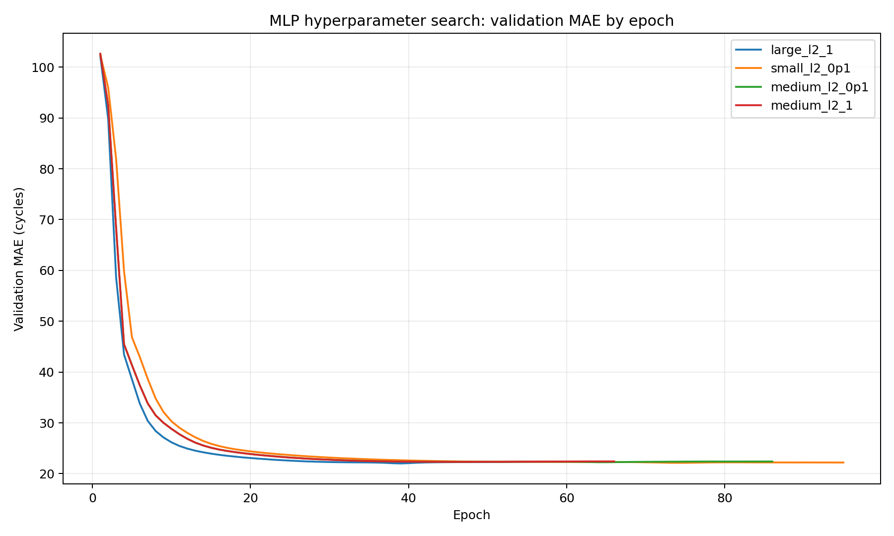
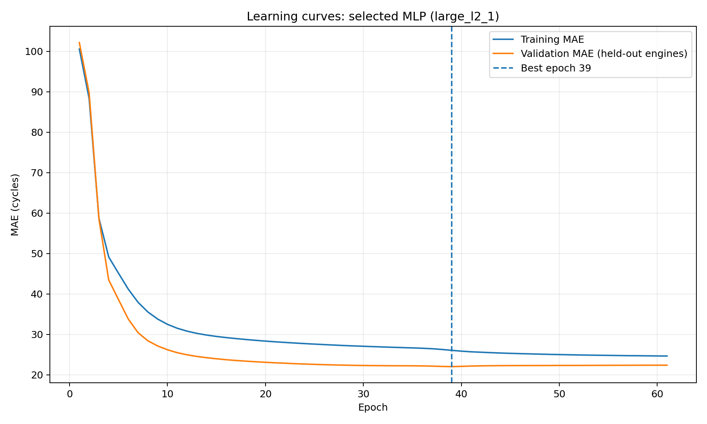
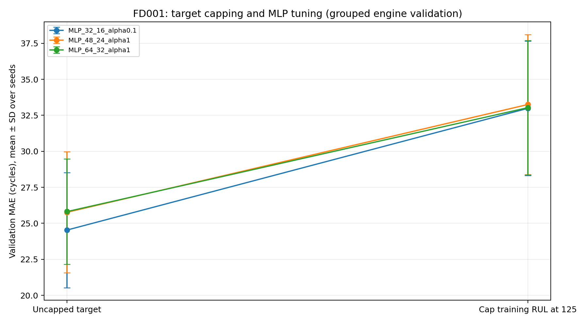

# Обучение MLP, кривые обучения и подбор гиперпараметров

## 1. Как обучается нейронная сеть

Модель решает задачу **регрессии**: по признакам текущего цикла предсказывает остаточный ресурс двигателя в циклах. Для известных завершённых обучающих траекторий целевая величина равна `max_cycle(engine) - cycle`. Вектора входных признаков содержат рабочие условия, показания информативных датчиков и номер цикла; истинный RUL, идентификатор двигателя и длина будущей траектории в признаки не входят.

**Архитектура:** полносвязный многослойный персептрон `MLPRegressor` с двумя скрытыми слоями, нелинейностью ReLU и линейным выходом для регрессии. Сеть оптимизирует квадратичную ошибку с L2-регуляризацией весов (параметр `alpha`) методом Adam; размер мини-батча 200, скорость обучения 0.001, seed 42. Для отчёта дополнительно отслеживается **MAE**, поскольку она интерпретируется непосредственно в циклах.

**Подготовка:** пропуски заполняются медианой, признаки стандартизируются (`StandardScaler`). Оба преобразования обучаются **только на обучающих двигателях**. Для независимой валидации выбраны 20 двигателей; 40 целых траекторий (7 954 строки) используются в обучении. Тестовые 100 двигателей не используются ни для подбора параметров, ни для остановки обучения.

**Порядок обучения по эпохам:** один вызов `partial_fit` выполняет одну эпоху прохода по обучающим наблюдениям; после эпохи рассчитываются MAE на обучающих и валидационных данных. Запоминаются веса в эпоху наименьшей валидационной MAE. Обучение конкретной конфигурации прекращается после 22 эпох без улучшения минимум на 0.01 цикла (не ранее 35-й эпохи), либо при лимите 160 эпох. Это **отдельный эксперимент**, отличающийся от исходного запуска `experiment.py`, где применялся внутренний `early_stopping=True`.

## 2. Сетка гиперпараметров и результат выбора

Проверены четыре **заранее заданные** конфигурации; изменялись размер скрытых слоёв и коэффициент L2-регуляризации `alpha`. Скорость обучения и другие настройки фиксированы. Выбор конфигурации и эпохи выполнен **только по валидационной MAE всех циклов 20 отложенных двигателей**.

| Конфигурация | Слои | alpha | Фактически эпох | Лучшая эпоха | MAE на валидации |
|---|---|---:|---:|---:|---:|
| `large_l2_1` | (64, 32) | 1 | 61 | 39 | 22.015 |
| `small_l2_0p1` | (32, 16) | 0.1 | 95 | 73 | 22.145 |
| `medium_l2_0p1` | (48, 24) | 0.1 | 86 | 64 | 22.254 |
| `medium_l2_1` | (48, 24) | 1 | 66 | 44 | 22.327 |

Победила конфигурация **`large_l2_1`** (64 и 32 нейрона в скрытых слоях, `alpha=1`), на эпохе **39** с валидационной MAE **22.015** цикла. На штатном тесте, вычисленном **после выбора**, получены **MAE 19.629** и **RMSE 25.699** цикла.



## 3. Кривые обучения



**Интерпретация:** на первых эпохах ошибка снижается вследствие обучения весов. После лучшей эпохи валидационная MAE перестаёт устойчиво улучшаться; при этом тренировочная ошибка может продолжать снижаться. Это основание для выбора весов по **минимуму валидационной MAE**, а не по последней эпохе. Неровности линий ожидаемы для стохастической оптимизации Adam.

## 4. Сравнение с исходным результатом

В первоначальном эксперименте `experiment.py` MLP (48, 24) с внутренней ранней остановкой имела тестовую **MAE 19.46**. Подобранная по валидации конфигурация настоящего дополнительного эксперимента имеет **MAE 19.63** на том же тесте. Подбор гиперпараметров не гарантирует улучшения на тестовой выборке; новое значение не следует представлять как «лучше» первоначального. При этом результаты дополнительного эксперимента методологически показывают процедуру обучения, кривые и **выбор по отложенным двигателям**, как требует замечание преподавателя.

## 5. Воспроизводимость и ограничения

```bash
python -m pip install -r requirements.txt
python train_mlp_tuning.py --zip /path/to/CMAPSSData.zip --out ./tuning
```

Скрипт сохраняет `tuning_results.csv`, `learning_curve.csv`, `tuning_comparison.png`, `learning_curves.png`, `tuned_test_predictions.csv`, `tuning_info.json`. Входной датасет **не включён** в репозиторий. В исследовании используются только текущие измерения без временных окон; результаты зависят от seed, фиксированного разбиения, набора параметров и состава FD001. Это сравнительный учебный эксперимент, а не оценка эксплуатационной надёжности реальных двигателей.


## Дополнительное исследование: устойчивость, ограничение RUL и MAPE (19.11.2026)

По замечанию преподавателя реализован скрипт `robustness_study.py`, который повторяет разбиение **по целым двигателям** при `seed ∈ {17, 42, 73}`. На каждом разбиении обучаются модели по полным траекториям с общим лимитом 8 000 обучающих циклов; новые участники валидации не пересекаются с обучающими. Сравниваются MLP (32,16) c `alpha=0.1`, (48,24) с `alpha=1`, (64,32) с `alpha=1`, а также два режима целевой переменной: исходный RUL и `min(RUL,125)` **только при обучении**. Тестовые метки не используются при выборе моделей в этой серии экспериментов.

| Модель | MAE без cap, среднее ± SD | MAE с cap=125, среднее ± SD |
|---|---:|---:|
| `MLP_32_16_alpha0.1` | 24.53 ± 4.00 | 32.98 ± 4.68 |
| `MLP_48_24_alpha1` | 25.77 ± 4.19 | 33.25 ± 4.86 |
| `MLP_64_32_alpha1` | 25.82 ± 3.66 | 33.03 ± 4.66 |

Установка `RUL_cap=125` **не улучшила общую MAE** в проверенных конфигурациях: модель систематически недооценивает большую оставшуюся жизнь. В диапазоне `RUL ≤ 30` ограничение иногда улучшает MAE; это демонстрирует компромисс между качеством в предаварийной зоне и точностью в начале жизненного цикла. Результат зависит от конфигурации, выборки и 100 эпох обучения; **не является доказательством**, что любой вариант capped-RUL хуже.

**MAPE:** `100/n * Σ |y_i-ŷ_i|/|y_i|`. При `y_i=0` MAPE не определена и не должна вычисляться делением на ноль. На штатном FD001 test (100 последних строк, минимальное истинное RUL = 7) нулевых меток нет, поэтому MAPE рассчитывается непосредственно. Для валидационных траекторий (где RUL=0 в момент отказа) приводятся MAPE только при RUL>0, дополнительная MAPE для RUL≥10 и симметричная sMAPE, с явным указанием фильтра. Даже без нулей MAPE чувствительна к очень малым знаменателям.

| Тестовая модель | MAE (циклы) | MAPE (%) | sMAPE (%) |
|---|---:|---:|---:|
| Age only | 29.15 | 80.67 | 47.85 |
| Ridge sensors | 23.30 | 53.07 | 38.26 |
| MLP sensors | 22.50 | 36.44 | 28.36 |
| MLP sensors + cycle | 19.46 | 31.07 | 29.59 |

**Границы выводов:** подбор по трем seed — это сравнение на трех валидационных разделениях, а не внешняя проверка на трех независимых тестовых наборах. Test FD001 ранее использовался для итоговой оценки первоначальных моделей, а результаты новой серии представлены отдельно; новая серия не заменяет прежнюю оценку теста. Сравнение построено на 3 архитектурах, 2 ограничениях и 100 эпохах, а не на полном оптимизационном поиске.

График: . Исходные таблицы: `robustness_results.csv`, `robustness_summary.csv`, `test_percentage_metrics.csv`.

Повторный запуск:

```bash
python robustness_study.py --zip CMAPSSData.zip --out . --seeds 17 42 73 --max-iter 100
```
