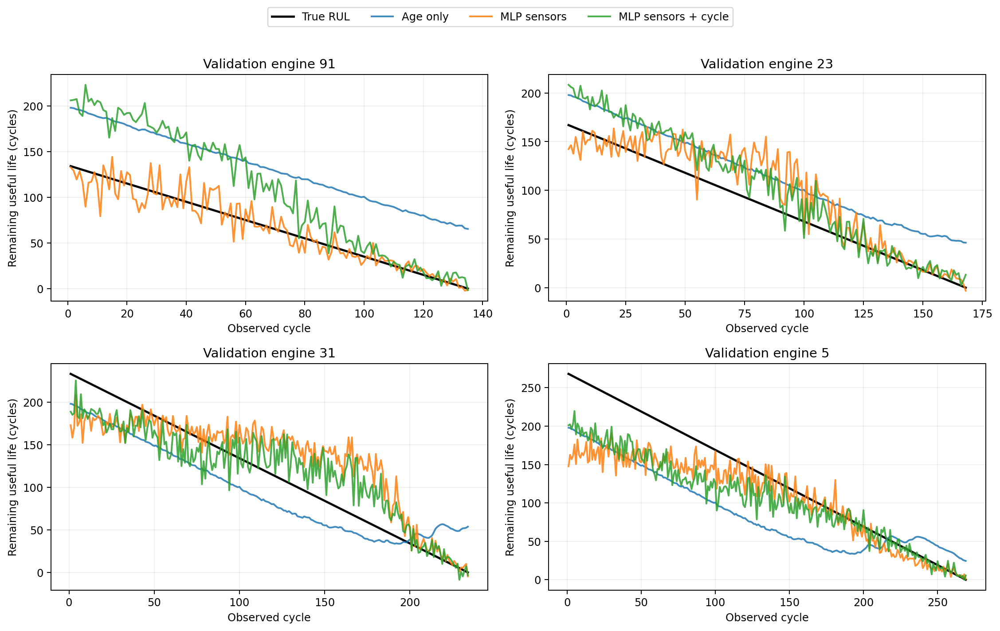
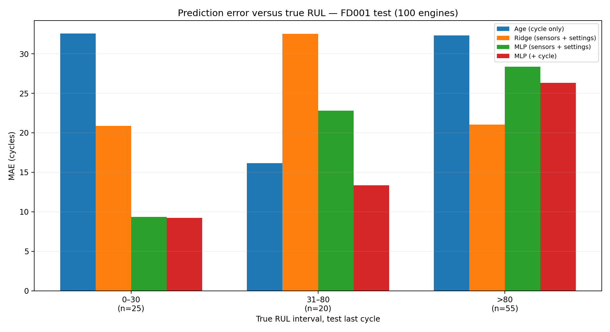
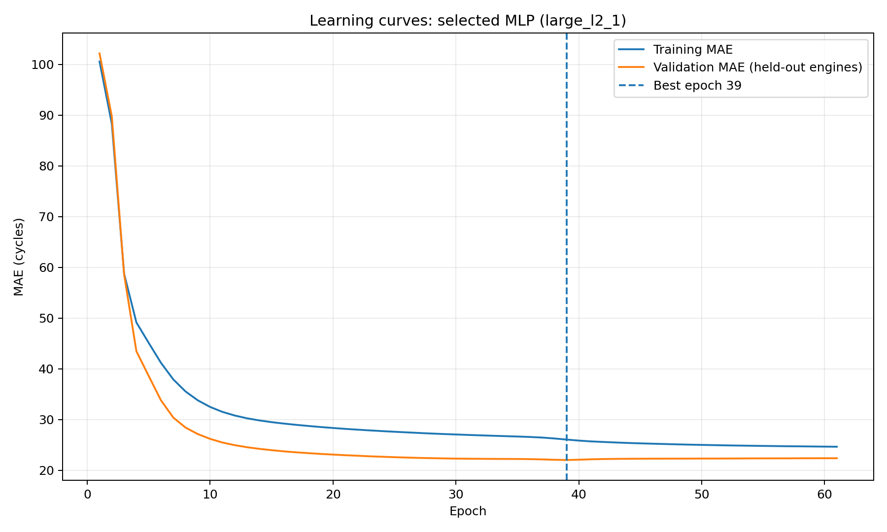
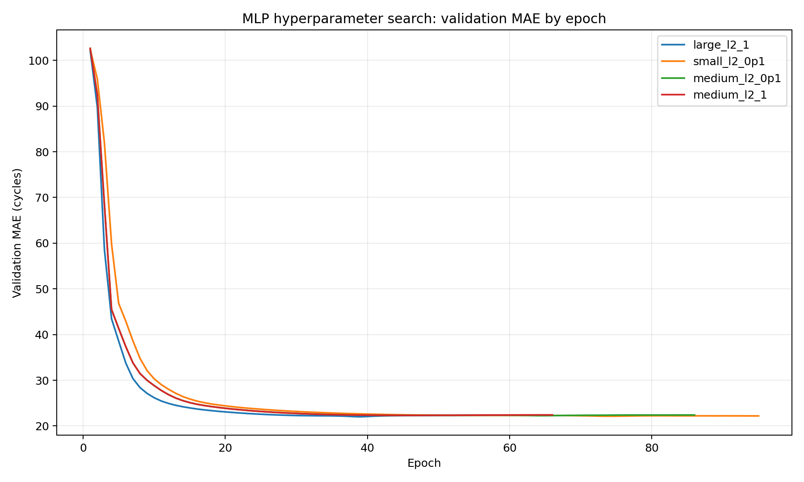
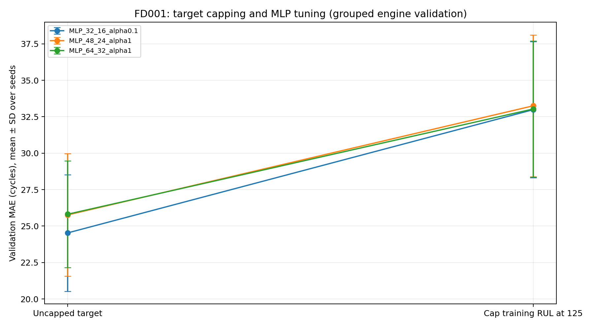
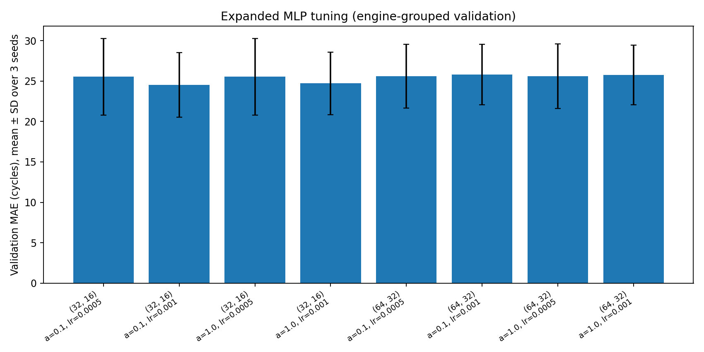
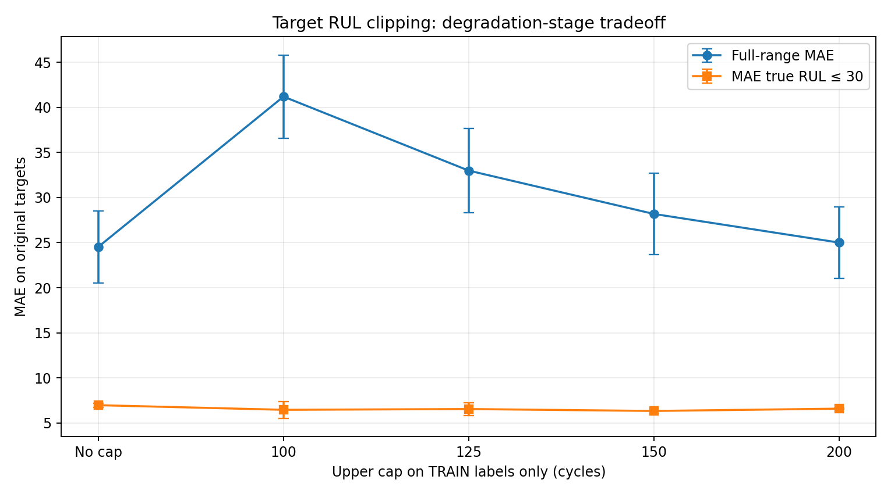

# Прогноз остаточного ресурса авиационного двигателя — NASA C-MAPSS FD001

Исследование по машинному обучению (вариант 12): **предсказание Remaining Useful Life (RUL)** авиационного двигателя на основе рабочих условий, показаний датчиков и номера цикла.

**Исследовательский вопрос:** способна ли нейронная сеть MLP извлекать из показаний датчиков информацию о деградации, недоступную модели, использующей только номер цикла? Насколько показания датчиков полезны при малом остаточном ресурсе?

## Основной результат

На официальном тестовом наборе **FD001 (100 двигателей; последняя доступная строка каждого)** наименьшую ошибку дала MLP с датчиками и номером цикла: **MAE = 19.46 цикла** и **RMSE = 25.60 цикла**, что соответствует снижению MAE на **33.3%** относительно модели только по циклу.

| Модель | Признаки | MAE ↓ | RMSE ↓ |
|---|---|---:|---:|
| Age only — Random Forest | Номер цикла | 29.15 | 35.14 |
| Ridge | Датчики + рабочие условия | 23.30 | 29.13 |
| MLP | Датчики + рабочие условия | 22.50 | 30.50 |
| **MLP + cycle** | **Датчики + рабочие условия + номер цикла** | **19.46** | **25.60** |

### Прогноз RUL на отложенных двигателях



Для визуализации полных кривых использованы **валидационные** двигатели: для обучающих траекторий известен момент отказа, а для штатного теста RUL задан только для последней наблюдаемой строки.

### Ошибка по диапазонам истинного RUL



| Модель | RUL 0–30 (n=25) | RUL 31–80 (n=20) | RUL >80 (n=55) |
|---|---:|---:|---:|
| Только цикл | 32.57 | 16.15 | 32.33 |
| Ridge | 20.88 | 32.51 | 21.05 |
| MLP — датчики | 9.35 | 22.81 | 28.36 |
| **MLP — датчики + цикл** | **9.24** | **13.36** | **26.32** |

**Вывод:** при RUL ≤ 30 MLP на датчиках показывает MAE 9.35 против 32.57 у возрастной модели (снижение примерно на **71.3%**). Это свидетельствует о пользе измерений состояния в рамках данного эксперимента, но не доказывает универсальность эффекта для других наборов данных.

## Данные и постановка задачи

Используется **NASA C-MAPSS FD001**: симуляция деградации турбовентиляторных двигателей, 100 полных обучающих траекторий (20 631 строка), 100 неполных тестовых траекторий, 3 параметра рабочих условий и 21 датчик.

Для обучающего двигателя целевая переменная вычисляется как:

```text
RUL(engine, cycle) = max_cycle(engine) - cycle
```

`RUL` и итоговая длина траектории **не входят во входные признаки**. На официальном тесте `RUL_FD001.txt` содержит истинный RUL **только для последней доступной строки каждого двигателя**.

## Методология

1. Разбиение по целым `engine_id`, а не по случайным строкам: двигатели в обучении и валидации не пересекаются.
2. Обучение на **40 полных траекториях (7 954 цикла)** — меньше ограничения 8 000 циклов; валидация на **20 других двигателях (4 070 циклов)**.
3. Постоянные признаки исключаются по обучающей выборке; заполнение пропусков и стандартизация настраиваются **только по обучающим данным** через scikit-learn `Pipeline`.
4. Сравниваются четыре модели с фиксированными параметрами, без выбора по тестовым меткам.
5. Итоговая оценка на официальном тесте проводится по 100 последним наблюдениям, в целом и отдельно по диапазонам истинного RUL.

**Важно:** возрастная базовая модель — это `RandomForestRegressor` с одним признаком `cycle`, а не линейная регрессия. MLP с циклом достигла предела `max_iter=350` с предупреждением о недостигнутой сходимости, что отмечено в отчёте.

## Структура репозитория

```text
nasa-cmapss-fd001-rul/
├── README.md                  # Описание проекта и результаты
├── experiment.py             # Воспроизводимый эксперимент
├── requirements.txt          # Зависимости Python
├── .gitignore                 # Исключения Git
├── REPORT.md                 # Подробный научный отчёт
├── metrics.csv               # MAE/RMSE на всех разбиениях
├── test_predictions.csv      # Предсказания на 100 тестовых двигателях
├── validation_predictions.csv# Предсказания для всех циклов валидации
├── run_info.txt              # Состав выборок и признаков
├── rul_trajectories.png      # График траекторий
└── mae_by_rul.png             # График ошибок по диапазонам RUL
```

## Как воспроизвести результаты

Нужен Python и архив C-MAPSS с файлами `train_FD001.txt`, `test_FD001.txt` и `RUL_FD001.txt` **в корне ZIP**. Архив данных не включён в репозиторий. Получите его из оригинального источника NASA C-MAPSS (Prognostics Center of Excellence) или используйте имеющуюся копию `CMAPSSData.zip`.

```bash
# Из папки проекта
python -m venv .venv

# Linux/macOS:
source .venv/bin/activate
# Windows PowerShell вместо предыдущей команды:
# .venv\Scripts\Activate.ps1

python -m pip install -r requirements.txt
python experiment.py --zip /path/to/CMAPSSData.zip --out ./output
```

В Windows вместо `/path/to/CMAPSSData.zip` укажите путь, например `C:\datasets\CMAPSSData.zip`. Скрипт сохранит новые `metrics.csv`, прогнозы, графики и `run_info.txt` в каталоге `output/`. Для сопоставления с опубликованными результатами применяется `random_state=42`.

## Дополнительный эксперимент: обучение и подбор MLP

В ответ на замечания преподавателя добавлен **[подробный разбор обучения сети](MODEL_TRAINING.md)** с описанием архитектуры, функции потерь, оптимизатора Adam, регуляризации, ранней остановки и контроля утечки данных. Проведён подбор **четырёх конфигураций MLP** по независимой валидационной выборке. Лучшая по валидации конфигурация: **(64, 32), alpha=1, эпоха 39**; валидационная MAE **22.015**, тестовая MAE **19.629** цикла.

**Кривая обучения выбранной модели:**



**Сравнение конфигураций по эпохам:**



Это отдельный дополнительный эксперимент. Ранее опубликованная тестовая MAE 19.46 получена исходным `experiment.py`; подбор по валидации не обязан улучшать тестовый показатель. Тестовые метки не использовались при выборе параметров.

Для повторения дополнительного эксперимента:

```bash
python train_mlp_tuning.py --zip /path/to/CMAPSSData.zip --out ./tuning
```

**[Скачать PDF-отчёт](REPORT.pdf)** с методологией, графиками и результатами.

## Ограничения

- FD001 — **симулятор**, а не натурные измерения реальных авиационных двигателей; один режим работы и один механизм деградации.
- Только одно разделение по двигателям (seed 42), без доверительных интервалов и повторных запусков.
- MLP использует текущую строку датчиков, без временных окон и накопленной истории.
- `early_stopping` внутри MLP использует случайную часть строк **только обучающих двигателей**; основная валидация по независимым двигателям не участвует в остановке.
- Сравнение относится именно к этим моделям и этим гиперпараметрам; выбор модели по итогам теста следует интерпретировать как результат данного эксперимента.

Подробные настройки, протокол и анализ приведены в **[REPORT.md](REPORT.md)**. Исходные экспериментальные результаты сохранены в CSV.

### Дополнительные файлы исследования

`train_mlp_tuning.py` — обучение и выбор MLP; `MODEL_TRAINING.md` — описание обучения; `REPORT.pdf` — PDF-отчёт; `learning_curves.png` и `tuning_comparison.png` — кривые; `tuning_results.csv`, `learning_curve.csv`, `tuned_test_predictions.csv`, `tuning_info.json` — численные результаты.


## Дополнительное исследование: устойчивость, ограничение RUL и MAPE (19.11.2026)

По замечанию преподавателя реализован скрипт `robustness_study.py`, который повторяет разбиение **по целым двигателям** при `seed ∈ {17, 42, 73}`. На каждом разбиении обучаются модели по полным траекториям с общим лимитом 8 000 обучающих циклов; новые участники валидации не пересекаются с обучающими. Сравниваются MLP (32,16) c `alpha=0.1`, (48,24) с `alpha=1`, (64,32) с `alpha=1`, а также два режима целевой переменной: исходный RUL и `min(RUL,125)` **только при обучении**. Тестовые метки не используются при выборе моделей в этой серии экспериментов.

| Модель | MAE без cap, среднее ± SD | MAE с cap=125, среднее ± SD |
|---|---:|---:|
| `MLP_32_16_alpha0.1` | 24.53 ± 4.00 | 32.98 ± 4.68 |
| `MLP_48_24_alpha1` | 25.77 ± 4.19 | 33.25 ± 4.86 |
| `MLP_64_32_alpha1` | 25.82 ± 3.66 | 33.03 ± 4.66 |

Установка `RUL_cap=125` **не улучшила общую MAE** в проверенных конфигурациях: модель систематически недооценивает большую оставшуюся жизнь. В диапазоне `RUL ≤ 30` ограничение иногда улучшает MAE; это демонстрирует компромисс между качеством в предаварийной зоне и точностью в начале жизненного цикла. Результат зависит от конфигурации, выборки и 100 эпох обучения; **не является доказательством**, что любой вариант capped-RUL хуже.

**MAPE:** `100/n * Σ |y_i-ŷ_i|/|y_i|`. При `y_i=0` MAPE не определена и не должна вычисляться делением на ноль. На штатном FD001 test (100 последних строк, минимальное истинное RUL = 7) нулевых меток нет, поэтому MAPE рассчитывается непосредственно. Для валидационных траекторий (где RUL=0 в момент отказа) приводятся MAPE только при RUL>0, дополнительная MAPE для RUL≥10 и симметричная sMAPE, с явным указанием фильтра. Даже без нулей MAPE чувствительна к очень малым знаменателям.

| Тестовая модель | MAE (циклы) | MAPE (%) | sMAPE (%) |
|---|---:|---:|---:|
| Age only | 29.15 | 80.67 | 47.85 |
| Ridge sensors | 23.30 | 53.07 | 38.26 |
| MLP sensors | 22.50 | 36.44 | 28.36 |
| MLP sensors + cycle | 19.46 | 31.07 | 29.59 |

**Границы выводов:** подбор по трем seed — это сравнение на трех валидационных разделениях, а не внешняя проверка на трех независимых тестовых наборах. Test FD001 ранее использовался для итоговой оценки первоначальных моделей, а результаты новой серии представлены отдельно; новая серия не заменяет прежнюю оценку теста. Сравнение построено на 3 архитектурах, 2 ограничениях и 100 эпохах, а не на полном оптимизационном поиске.

График: . Исходные таблицы: `robustness_results.csv`, `robustness_summary.csv`, `test_percentage_metrics.csv`.

Повторный запуск:

```bash
python robustness_study.py --zip CMAPSSData.zip --out . --seeds 17 42 73 --max-iter 100
```


## Расширенный эксперимент по замечаниям преподавателя (ноябрь 2026)

Проведены **39 дополнительных обучений MLP**: 8 конфигураций (2 архитектуры × 2 L2-регуляризации × 2 скорости обучения) по трём разбиениям двигателей и 5 вариантов ограничения тренировочного RUL (без ограничения, 100, 125, 150, 200). Лимит 8000 обучающих строк сохранён в каждом запуске.

| Критерий | Итог |
|---|---|
| Лучший средний валидационный MAE | 24.53 цикла, MLP (32,16), alpha=0.1, lr=0.001 |
| Валидационная MAE по RUL ≤30 | 6.34 при ограничении обучающего RUL до 150 |
| Общая MAE без ограничения / cap=150 | 24.53 / 28.18 |
| Тестовая MAE расширенной модели при seed 42 | 18.99 цикла |
| Тестовая MAPE / sMAPE | 33.98% / 32.32% |





Дополнительные файлы: `extended_study.py`, `extended_grid.csv`, `extended_grid_summary.csv`, `extended_caps.csv`, `extended_caps_summary.csv`, `extended_tuning.png`, `extended_plateau.png`, `extended_rul_caps.png`. Полный отчёт с таблицами и графиками: [REPORT.pdf](REPORT.pdf).

Для воспроизведения: `python extended_study.py --zip CMAPSSData.zip --out .`. Сравнения настроек проводились по отложенным двигателям, тест использован только для окончательной оценки; при RUL=0 обычная MAPE не вычисляется.
