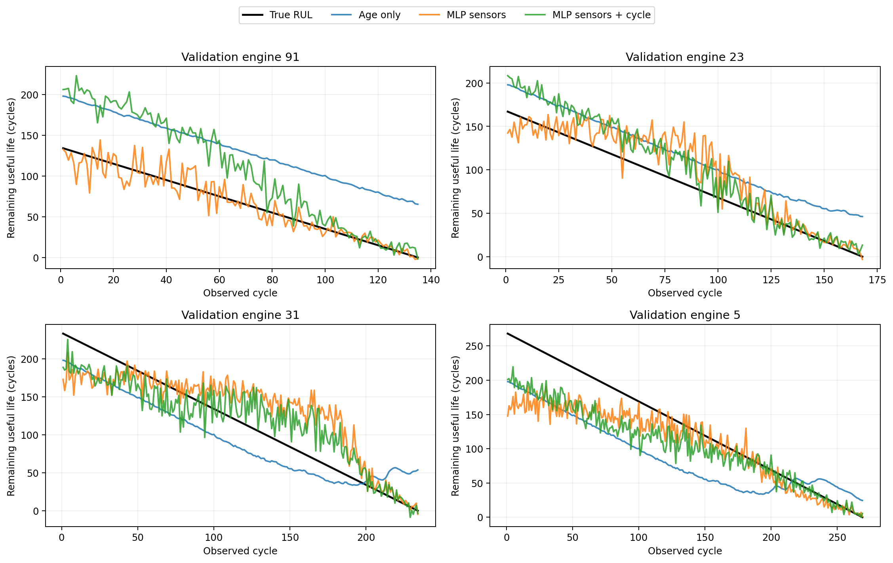
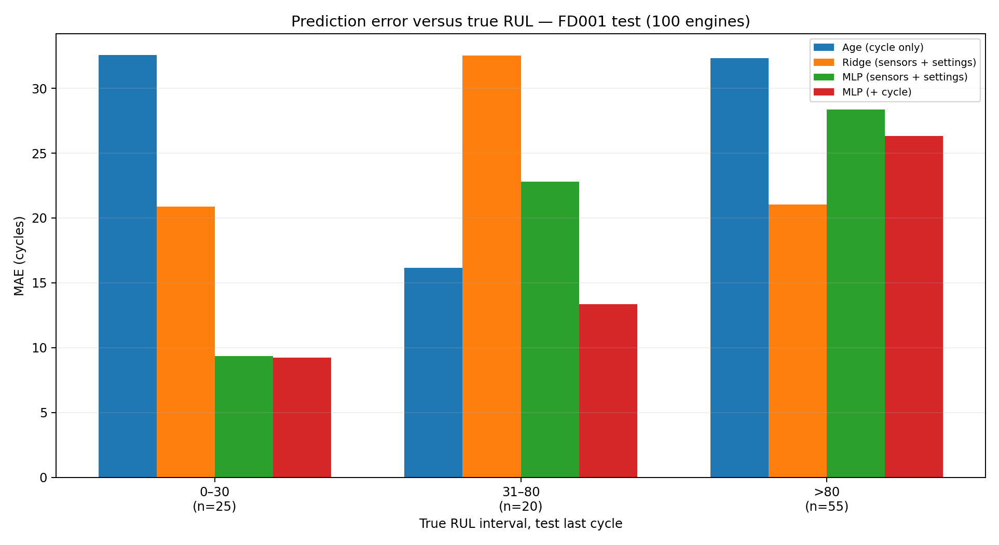

# Вариант 12. Прогноз остаточного ресурса авиационного двигателя (NASA C-MAPSS FD001)

## Цель и исследовательский вопрос

Проверить, извлекает ли многослойный персептрон (MLP) информацию о деградации двигателя из показаний датчиков сверх того, что можно получить по одному номеру цикла, и насколько полезны датчики при **малом истинном RUL**.

## Данные

Исходный архив: `CMAPSSData.zip`. Использованы только `train_FD001.txt`, `test_FD001.txt` и `RUL_FD001.txt`. Согласно `readme.txt` архива FD001 включает 100 обучающих и 100 тестовых двигателей, одно рабочее условие (sea level), один тип деградации (HPC degradation). Обучающая часть содержит **20 631 наблюдение**. Столбцы: `engine_id`, `cycle`, 3 рабочих режима, 21 сенсор.

На обучающих траекториях истинный RUL вычислен **только как целевая величина**: `max(cycle по двигателю) - cycle`. Он не используется как входной признак. Для тестовой части `RUL_FD001.txt` даёт истинное значение RUL **лишь для последней строки каждого двигателя**; для других тестовых строк этот RUL неизвестен.

## Протокол эксперимента

1. Список из 100 обучающих `engine_id` разбит на 80 потенциально обучающих и 20 валидационных (`train_test_split`, `random_state=42`). По строкам одного двигателя разбиение **не** выполняется.
2. В пределах 80 потенциально обучающих двигателей отобраны **40 полных траекторий, 7 954 цикла**, то есть не более 8 000. Остальные двигатели из этих 80 не использованы. Валидация: **20 совершенно других двигателей, 4 070 циклов**.
3. Удалены строго постоянные по выбранной обучающей части признаки. Для регрессии по сенсорам использованы остальные датчики и рабочие условия; признака `engine_id` нет.
4. Обработка пропусков и стандартизация для Ridge/MLP выполняются внутри `Pipeline`, обученного только на обучающей части; на валидации и тесте параметры не подгоняются. Прогнозы не обрезаются искусственно по RUL.
5. Сравнены четыре модели с заранее заданными параметрами, без подбора на тесте. Финальная оценка — штатные 100 тестовых двигателей, **по последней доступной строке**, как предусмотрено форматом `RUL_FD001`.
6. Все результаты воспроизводимы запуском `experiment.py` с исходным архивом. Для точного повторения среды использована `scikit-learn 1.8.0`, генератор случайных чисел с seed 42.

### Модели

- **Возрастная (только цикл)**: RandomForestRegressor (100 деревьев, `min_samples_leaf=25`) с единственным входом `cycle`. Это нелинейная возрастная модель без датчиков, не использующая будущую длину траектории.
- **Ridge**: линейная модель с L2-регуляризацией (`alpha=100`) на рабочих условиях и датчиках.
- **MLP — датчики**: `MLPRegressor(hidden_layer_sizes=(48,24), alpha=1, max_iter=350, early_stopping=True)` на рабочих условиях и датчиках.
- **MLP — датчики и цикл**: аналогичная сеть с дополнительным входом `cycle`.

Важно: `early_stopping` в реализации MLP использует случайную долю строк **только внутри 40 обучающих двигателей**. Основная валидационная выборка (20 других двигателей) в подгонке и early stopping не используется. У MLP с циклом сработало ограничение `max_iter=350` и появилось предупреждение о недостигнутой сходимости: дальнейшая настройка может изменить численные результаты.

## Итог: штатный тест FD001

MAE и RMSE указаны в циклах, оба показателя меньше — лучше.

| Модель | MAE | RMSE |
|:--|--:|--:|
| Только цикл | 29.15 | 35.14 |
| Ridge — датчики и режимы | 23.30 | 29.13 |
| MLP — датчики и режимы | 22.50 | 30.50 |
| **MLP — датчики, режимы и цикл** | **19.46** | **25.60** |

MLP с датчиками без возраста уменьшила MAE относительно возрастной модели на **22.8%**: `(29.1544 - 22.4990)/29.1544`. Добавление цикла к MLP дополнительно уменьшило MAE с 22.50 до 19.46 (на **13.5%** относительно MLP без цикла). Против возрастного базового уровня комбинированная MLP даёт снижение MAE **33.3%**.

Дополнительная диагностика по 20 валидационным двигателям, **все циклы**: возрастная модель MAE 34.19; Ridge 29.93; MLP без цикла 25.75; MLP с циклом 25.14. Важно: последние строки обучающих (run-to-failure) валидационных двигателей имеют истинный RUL=0, поэтому оценка **только** их последних строк не сопоставима с тестовыми остановленными траекториями.

## Ошибка по величине истинного RUL

Группировка по RUL в `RUL_FD001`, по последней строке каждого тестового двигателя:

| Модель | RUL 0–30 (n=25) | RUL 31–80 (n=20) | RUL >80 (n=55) |
|:--|--:|--:|--:|
| Только цикл | 32.57 | 16.15 | 32.33 |
| Ridge | 20.88 | 32.51 | 21.05 |
| MLP — датчики | 9.35 | 22.81 | 28.36 |
| **MLP — датчики + цикл** | **9.24** | **13.36** | 26.32 |

**На стадии малого RUL (≤30)** сенсорная MLP снижает ошибку с 32.57 до 9.35 циклов относительно модели только по возрасту (примерно **71.3%**), а комбинированная MLP — до 9.24 циклов (**71.6%**). Результат поддерживает гипотезу, что измеряемая деградация несёт больше полезной информации при близком отказе. Однако группы имеют разный размер, и универсальность результата ограничена симулятором FD001. Для группы RUL 31–80 обычная Ridge хуже возрастной модели; следовательно, пользу датчиков нельзя утверждать одинаково для любого диапазона и любой модели.

## Два предметных графика

### 1. Прогноз RUL по мере старения на четырёх полностью отложенных двигателях



Траектории выбраны среди **валидационных**, а не тестовых двигателей: только для обучающей части FD001 известен истинный RUL на каждом цикле. Чёрная линия — истинная остаточная жизнь, остальные линии — прогнозы трёх моделей. График позволяет оценить, улавливают ли датчики изменение состояния по мере накопления циклов. Прогнозы могут не быть монотонными: такого ограничения на модели не наложено.

### 2. MAE при малом, среднем и большом истинном RUL



Столбцы построены **по штатному тесту**, только из последних доступных строк. Число двигателей в каждой группе указано на оси X. Высокая ошибка при большом RUL показывает более высокую неопределённость ранней стадии работы двигателя.

## Ограничения и заключение

- FD001 — моделируемые двигатели, а не реальные результаты эксплуатации авиационных двигателей. Один режим работы и один вид отказа ограничивают обобщение.
- Используется одна фиксированная схема разбиения и один случайный seed. Для научно более уверенной оценки нужны повторные разбиения по `engine_id` и доверительные интервалы.
- Признаки рассматриваются только в текущем цикле (нет скользящих окон или истории измерений). Временная динамика могла бы улучшить точность, но не проверялась.
- Длина полной траектории не является признаком; тестовые истинные RUL используются только для измерения качества, а не для обучения.
- В качестве возрастной модели используется случайный лес по номеру цикла, а не простая линейная экстраполяция. Сравнение потому не гарантирует выигрыш над **любой** возможной моделью по возрасту.
- Нет подбора гиперпараметров. Выводы количественно относятся к данным моделям и данному разбиению.

**Вывод.** В рамках проведённого контролируемого эксперимента показания датчиков содержат дополнительную информацию о деградации по сравнению с номером цикла. Особенно заметен эффект при RUL ≤30: MAE сенсорной MLP составляет 9.35 цикла против 32.57 у модели по циклу. Лучшая общая тестовая точность (MAE 19.46 цикла) достигается MLP, объединяющей сенсоры и номер цикла.

## Артефакты и повторный запуск

В каталоге: `experiment.py` — полный код обучения и графиков; `metrics.csv` — метрики всех разбиений и диапазонов; `test_predictions.csv` — построчные прогнозы на 100 тестовых двигателях; `validation_predictions.csv` — прогнозы для каждого цикла 20 валидационных двигателей; `run_info.txt` — точный состав разбиения и признаков; `rul_trajectories.png` и `mae_by_rul.png` — графики.

Для воспроизведения в окружении с установленными `numpy`, `pandas`, `matplotlib`, `scikit-learn`:

```bash
python experiment.py --zip /path/to/CMAPSSData.zip --out ./fd001_results
```

Исходный архив пользовательских данных нужно подать отдельно — внутрь итогового ZIP с результатами он не включён.
